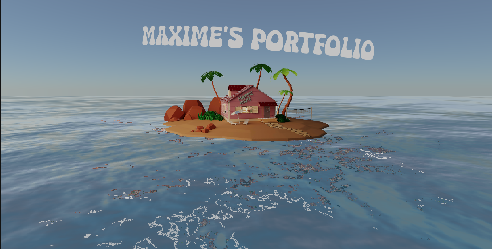

# Rajat Kashyap - 3D Developer & Growth Portfolio



### Welcome to my Professional 3D Portfolio

I am **Rajat Kashyap**, a Results-driven **Lead Generation Executive, Email Marketing Specialist, and Web Developer** with 6+ years of professional experience in technical operations, customer support, digital outreach, email automation, and responsive web development.

- 🌐 **Live Portfolio:** [https://rajat-kashyap.netlify.app](https://rajat-kashyap.netlify.app)
- 💼 **LinkedIn:** [https://www.linkedin.com/in/rajat-kashyap-040379194](https://www.linkedin.com/in/rajat-kashyap-040379194)
- 📧 **Email:** [rajatqwe8@gmail.com](mailto:rajatqwe8@gmail.com)
- 📞 **Contact:** +91 8318250417
- 📍 **Location:** Kanpur, Uttar Pradesh, India

---

### Project Architecture & Tech Stack

This project features an interactive 3D Kame House island world combined with a recruiter-friendly accessible portfolio HUD and overview system:

- **Frontend Core:** React 18, Vite
- **3D Engine:** Three.js, React Three Fiber (R3F), `@react-three/drei`
- **Animations:** GSAP & ScrollControls camera choreographer
- **Shaders:** Custom GLSL shaders (TV noise, smoke, particles, and hypnotizing canvas effects)
- **Styling & Layout:** Tailwind CSS & Vanilla CSS
- **Accessibility & SEO:** Dual-mode navigation with accessible HTML overlay and comprehensive Schema.org Person structured data

---

### Key Sections

1. **Interactive 3D Walkthrough:** Smooth camera scroll exploring the tropical island, living room, tech stack trophies, certification badges, and interactive TV terminal.
2. **Recruiter Overview Modal:** Instant one-click accessible view presenting verified employment history (Era Sky Technology, Globiva), project showcases, technical skill proficiencies, and education credentials (BCA from CSJM University).
3. **Resume Download:** Fast direct download for `Rajat-Kashyap-Resume.pdf`.

---

### Getting Started

```bash
# Install dependencies
npm install

# Start local development server
npm run dev

# Build production bundle
npm run build
```
